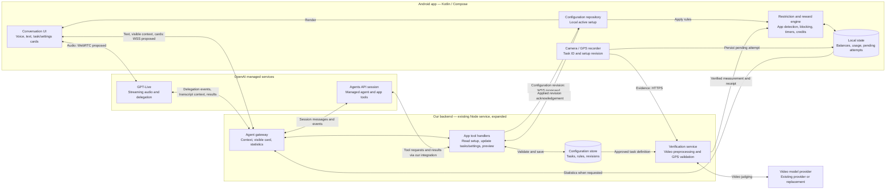

# Proposed runtime architecture

Superseded by [architecture v3](REBUILD_ARCHITECTURE_V3.md): the user chose function calling instead of the managed Agents API/coding-agent runtime. The v2 image is historical.

Technical proposal for discussion, not an implementation decision. The diagram below is the editable source of truth; the generated PNG is a visual companion. Its generated footer wording is not a confidentiality designation or additional architectural requirement.

## Proposed ownership

- The backend is authoritative for configuration; Android keeps an active local copy.
- Android executes blocking and reward rules and owns durable runtime state in this proposal, retaining existing foundations. Requiring a connection is a product rule, not a requirement to run every timer remotely.
- Our integration connects GPT-Live to the Agents API. No native direct connection between those APIs is assumed.
- Tool handlers validate changes; the agent cannot edit app source code or choose arbitrary capabilities.
- The verification service measures activity. The Android reward engine calculates credits from verified measurements.
- API transport feasibility, identity/authentication, server storage choice, reconnect behavior, conflict handling, and billing still require technical validation.
- Several boxes can run in the same backend deployment. They describe responsibilities, not a requirement for separate servers.

## Generated image

[Architecture image v2](REBUILD_ARCHITECTURE_V2.png)

Generated using the built-in image generation tool. The exact prompts are recorded in [REBUILD_ARCHITECTURE_V2_PROMPT.md](REBUILD_ARCHITECTURE_V2_PROMPT.md).
