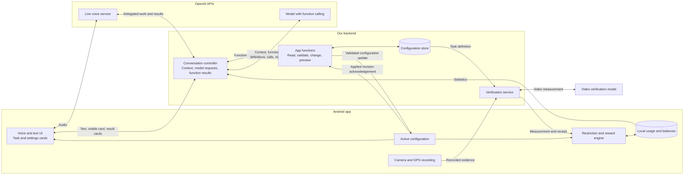

# Architecture v3 — conversation with app functions

> Historical proposal, superseded by [ARCHITECTURE_V2.md](ARCHITECTURE_V2.md) and the updated [product plan](REBUILD_PLAN_V1.md). The newer document has a lower version number because a separate diagram series was created. Immediate writes, omitted approval/undo steps and undecided model choices below describe the old proposal, not the current build direction.

Decision recorded on 2026-09-16: drop the managed Agents API/coding-agent runtime and use model function calling. This supersedes the v1/v2 illustrations. Product behavior remains defined in [REBUILD_PLAN_V1.md](REBUILD_PLAN_V1.md). No implementation is authorized by this document.

## Component diagram

## How a change happens

1. The user speaks or types. The conversation receives the current setup, relevant UI context, and statistics summary.
2. The model requests a supported function with structured arguments, for example `update_settings({ waitSeconds: 5 })`.
3. Our backend checks the arguments and user scope, saves valid changes, and sends the updated configuration to Android.
4. Android applies the revision and updates the UI; the backend returns the actual result to the conversation.
5. The model explains the outcome. Further function calls are allowed when needed to complete the request, but arbitrary code execution is outside this design.

## Initial function surface

- `get_setup`: read tasks and restriction settings.
- `create_task`, `update_task`, `pause_task`, `remove_task`: operate on task definitions.
- `update_settings`: change supported restriction settings and labels.
- `get_statistics`: retrieve recorded usage and activity.
- `preview_change`: simulate supported effects without changing rewards or progress.

Names and exact argument schemas are proposals, not implemented endpoints.

## What is settled and what remains proposed

- Settled: app behavior is changed through supported functions. No managed Agents API session, coding runtime, repository access, or shell is needed for this interface.
- Proposed: our backend stores configuration; Android executes rules and keeps runtime state, preserving the existing foundation.
- The separate voice and function-calling model boxes show responsibilities. Exact model choice and whether voice uses managed delegation or our own conversation controller remain to be validated.
- Verification remains separate from conversational configuration. The model measures evidence; ordinary app code calculates rewards.
- We still need to design authentication, request deduplication, connection recovery, configuration synchronization, and exact state ownership.
- Measure model usage across all calls for simple edits, task creation, and explanations. Report voice and verification costs separately. Earlier estimates for the hosted Agents API are not measured costs for this design.

## Current image

[Architecture image v3](REBUILD_ARCHITECTURE_V3.png) illustrates this proposal. The audio connection across the deployment boundaries represents Conversation UI to GPT-Live. The editable component diagram above specifies its endpoints precisely.

Generated with the built-in image tool; [generation prompts](REBUILD_ARCHITECTURE_V3_PROMPT.md) are saved alongside it. Earlier v1/v2 images depict superseded proposals.
